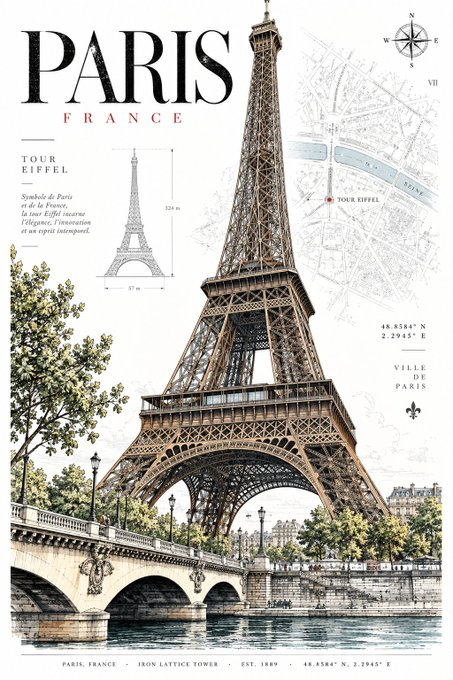
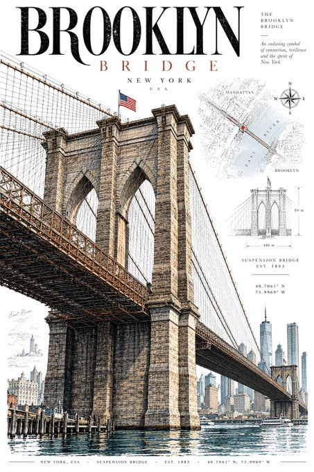

# P105. Architectural Travel Postcards

## 👀 Preview

[](../assets/p105-architectural-travel-postcards/source-example-01.jpg)

[](../assets/p105-architectural-travel-postcards/source-example-02.jpg)

## 👇 Workflow

`Destination → architectural travel postcard`

## 🔖 Full Prompt

```text
DESTINATION: [DESTINATION]

Create a sophisticated vertical 2:3 architectural travel postcard featuring [DESTINATION].

STYLE

Premium contemporary editorial postcard with subtle vintage influence. Combine precise architectural pen-and-ink illustration, restrained travel graphics, archival details, and modern graphic design. The result should feel cultured, timeless, architectural, and collectible—not like a tourist souvenir.

MAIN SUBJECT

Feature ONE iconic building, monument, structure, street façade, or architectural landmark strongly associated with [DESTINATION]. Make it the clear visual hero, shown from a believable three-quarter or slightly dramatic architectural perspective. No landmark collage.

ILLUSTRATION

Use exceptionally fine black or dark graphite linework, detailed architectural hatching, accurate proportions, and subtle hand-drawn imperfections. Include recognizable structural details such as windows, façades, roofs, columns, or ornaments where appropriate.

COLOR

Keep much of the architecture as line art with selective flat color using only 2–4 destination-specific tones. Colors should be sophisticated and slightly muted. Avoid gradients, glossy rendering, photorealism, excessive beige, and muddy sepia.

BACKGROUND

Use a clean pure white background with subtle archival elements such as faint maps, street plans, coordinates, contour lines, architectural diagrams, or minimal local-language annotations. Keep these elements secondary and lightly faded.

COMPOSITION

Vertical 2:3 format, with the landmark occupying roughly 60–75% of the artwork. Use generous negative space and an asymmetric editorial layout. Allow tasteful cropping when it improves the composition.

TYPOGRAPHY

Add restrained typography:

[LOCAL NAME]
[DESTINATION]

Use elegant architectural or museum-catalogue-inspired typography. Add a tiny bottom information strip with relevant details such as CITY / COUNTRY · ARCHITECTURE · EST. YEAR · COORDINATES.

DETAILS & MOOD

Add only a few tiny contextual elements—people, bicycles, trees, lamps, vehicles, or street details—when appropriate, mainly to establish scale.

Mood: quiet urban sophistication, cultural authenticity, history, and refined design.

AVOID

Tourist clichés, cartoon styling, fake architecture, landmark collages, giant typography, excessive decoration, heavy vintage filters, fake stamps, clutter, 3D rendering, and unnecessary text.

FINAL GOAL: A timeless, highly detailed, premium architectural postcard that feels like a museum-shop collectible or contemporary design print.
```

<sub>(by [@Goodmanprotocol](https://x.com/Goodmanprotocol/status/2104813775610384490)) · [Source: X](https://x.com/Goodmanprotocol/status/2104813775610384490)</sub>
