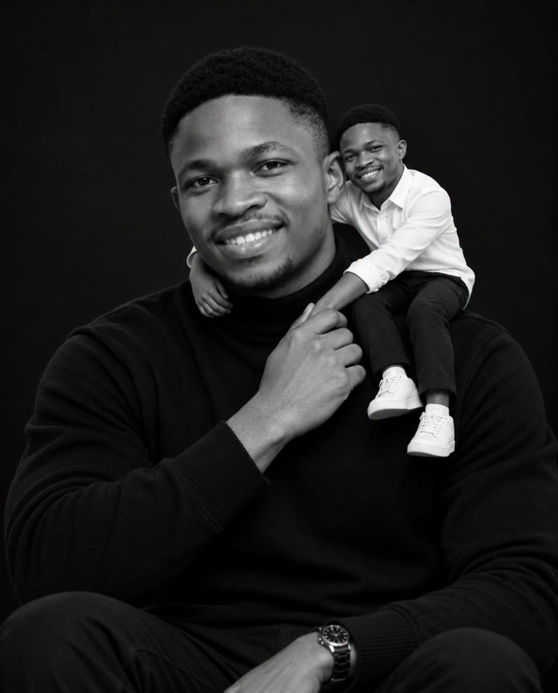

# P108. Monochrome Mini-Me Shoulder Portrait

## 👀 Preview

[](../assets/p108-monochrome-mini-me-shoulder-portrait/source-example-01.jpg)

## 👇 Workflow

`Portrait reference → monochrome portrait with a miniature self`

## 🔖 Full Prompt

```text
Use my uploaded photo as the exact identity reference for the main male subject. Preserve my facial identity, face shape, skin tone, hairstyle, hair texture, facial hair, eyes, nose, lips, and recognizable features with maximum consistency.
Create a hyper-realistic black-and-white cinematic portrait of me with a miniature version of myself (“mini me”).
The main subject is an adult man seated in a relaxed, confident pose against a deep black studio background. He wears a simple black turtleneck sweater with a clean, sophisticated appearance. His expression is calm, warm, and slightly serious as he looks directly into the camera.
A miniature adult version of the exact same man is sitting comfortably on the main subject’s shoulder and partially wrapping his arms around the main subject’s neck in an affectionate, playful pose. The mini-me must have the same face, hairstyle, facial hair, skin tone, and recognizable features as the main subject, but scaled down to approximately 20–25% of the adult’s height.
The main subject wears a simple, premium black sweatshirt with a relaxed fit, crew neckline, long sleeves, and clean minimal styling. The sweatshirt should have a realistic soft cotton texture with natural folds and fabric weight. No logos, graphics, text, or visible branding.
The mini-me wears a miniature white shirt, scaled naturally to his smaller body.
The main subject gently holds the mini-me’s arm with one hand, creating a believable physical connection between them. Make the interaction feel natural and emotionally warm rather than cartoonish.
Composition: vertical portrait, medium close-up, centered composition, both faces clearly visible, main subject occupying most of the frame, mini-me positioned naturally on the shoulder, symmetrical and visually balanced framing.
Camera: professional studio portrait photography, eye-level camera, approximately 85mm portrait lens, shallow depth of field while keeping both faces sharply focused, natural perspective, realistic proportions and scale.
Lighting: dramatic soft studio lighting from the front and slightly above, gentle highlights across the faces, subtle shadow falloff, beautifully sculpted facial features, realistic skin texture.
Color treatment: entirely black and white, rich monochrome tones, deep blacks, bright whites, subtle gray transitions, high contrast, timeless fine-art photography aesthetic.
Style: hyper-realistic photography, premium editorial portrait, cinematic fine-art photography, realistic skin pores, detailed hair strands, natural fabric texture, physically accurate shadows, realistic miniature scale, sophisticated and emotional, ultra-detailed, 8K.
Important: The mini-me must clearly be a miniature adult version of the same man, not a different person and not a random child. Maintain exact facial identity between the large subject and mini-me. Make the size difference obvious while keeping the mini-me anatomically realistic.
```

<sub>(by [Chinonso Victor](https://www.facebook.com/61565779293097/posts/try-this-viral-prompt-below-gpt-image-25/122212116734525976)) · [Source: Facebook](https://www.facebook.com/61565779293097/posts/try-this-viral-prompt-below-gpt-image-25/122212116734525976)</sub>
