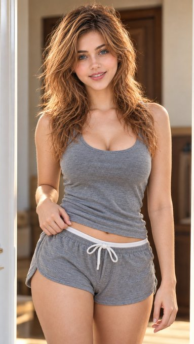

# P111. Copper Hair Doorway Portrait

## 👀 Preview

[](../assets/p111-copper-hair-doorway-portrait/source-example-01.jpg)

## 👇 Workflow

`Portrait reference → doorway lifestyle portrait`

Required input: your portrait reference. The original identity reference was not shared.

## 🔖 Full Prompt

```text
Hyper-realistic IMAX-level Netflix-style cinematic indoor lifestyle portrait, 9:16 vertical. Use the uploaded image as the primary visual reference and preserve the exact facial identity, proportions, and defining features. Create a woman wearing a fitted grey scoop-neck tank top and matching grey drawstring lounge shorts with a white waistband cord. She stands facing the camera with her shoulders relaxed, torso upright and hips subtly shifted; her right hand gently pinches the shorts’ waistband while her left arm hangs naturally beside her thigh. Her blue-green eyes look directly into the camera with relaxed eyelids and softly defined brows, paired with a warm, genuine smile showing her upper teeth and a friendly, approachable expression. Her voluminous copper-red hair has a deep side part, lifted roots and abundant loose, tousled waves cascading over both shoulders, with golden highlights catching the light. Fair luminous porcelain skin with a bright ivory to light beige tone, a neutral-cool undertone, natural freckles across her nose and cheeks, and realistic skin texture. Frame her in a softly lit indoor doorway with pale trim, warm beige walls and a blurred wooden door behind her. Warm natural light illuminates her face and hair, balanced by gentle shadows and subtle golden rim highlights. Apply a clean, warm editorial colour grade with rich copper and auburn hair tones, neutral grey clothing, natural skin colour, moderate contrast and soft background blur for a polished yet realistic photographic finish.
Negative prompt: altered identity, unnatural smile, artificial skin smoothing, distorted hands, incorrect fingers, exaggerated proportions, oversaturation, text, watermark.
```

<sub>(by [@imGopalTiwari](https://x.com/imGopalTiwari/status/2109545439452361017)) · [Source: X](https://x.com/imGopalTiwari/status/2109545439452361017)</sub>
