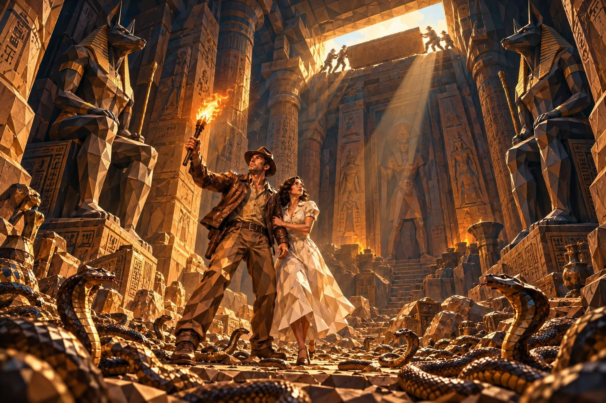

# P122. Faceted Well of Souls Adventure

## 👀 Preview

[](../assets/p122-faceted-well-of-souls-adventure/source-example-01.jpg)

## 👇 Workflow

`Text → faceted archaeological adventure scene`

## 🔖 Full Prompt

```text
Larger-than-life cinematic 3D adventure illustration, combining boldly sculpted geometric blocks, flowing contours, and extraordinary immersive depth. Every visible surface is constructed from prominent irregular polygonal facets, with deeply beveled edges, dark recessed seams, and strong tonal contrasts. Large, sharply defined geometric panels dominate clothing, statues, architecture, and environmental surfaces. Faces feature smaller, subtler sculpted facets, preserving recognizable features and natural expressions. The entire scene resembles a monumental three-dimensional mosaic sculpture, not conventional photorealism.
Inside the legendary Well of Souls beneath ancient Tanis, two adventurers stand surrounded by hundreds of snakes.
The man, resembling a rugged 1930s archaeologist in his late thirties, has a lean athletic build, broad shoulders, a square jaw, pronounced cheekbones, expressive hazel eyes, short dark-brown hair, and light stubble. He wears a battered brown fedora, weathered brown leather jacket, open-necked beige shirt, khaki trousers, leather belt, and worn boots.
Beside him stands a slender woman in her late twenties, with an oval face, expressive brown eyes, delicate features, and thick, shoulder-length wavy dark-brown hair. She wears a flowing ivory-white 1930s dress with short sleeves and a fitted waist.
Their clothing consists of large, distinctly sculpted polygonal panels with angular folds and pronounced geometric relief. Their faces retain finer facets.
The man raises a flaming torch while the woman grips his arm. Both look upward toward the distant ceiling opening, where several figures in 1930s clothing are sliding a single enormous, thin, flat rectangular sandstone slab horizontally across the entrance. The slab moves along stone grooves like a sliding lid, remaining perfectly horizontal. Its broad flat surface and thin edge are clearly visible. It is not a cube or a thick stone block. The opening is partially covered, allowing golden sunlight to penetrate the chamber.
The immense underground temple features towering hieroglyph-covered walls, gigantic sandstone columns, colossal statues of Anubis, ancient Egyptian carvings, and scattered archaeological relics. Every architectural element, including the distant background, displays large, deeply sculpted polygonal facets with strong angular boundaries.
Hundreds of snakes with geometric scales cover the stone floor, their flowing bodies contrasting with the rigid mosaic architecture.
Epic ultra-wide cinematic composition, dramatic 18mm perspective, camera positioned near floor level, looking upward. The two adventurers appear full-body in the lower central third, occupying approximately 35–40% of the image height. The monumental architecture dominates the scene, emphasizing the extraordinary height and depth of the chamber. Two colossal Egyptian statues frame the composition. The ceiling opening appears very high above, with the figures reduced to small silhouettes.
Intense golden sunlight streams through the narrowing entrance, contrasting with warm amber torchlight, burnt sienna, sandstone ochre, copper highlights, and deep petrol-blue shadows. Dramatic volumetric light beams, suspended dust, strong chiaroscuro, and directional lighting accentuate every geometric facet.
Premium cinematic CGI, exceptionally pronounced polygonal mosaic construction, sculpted geometric clothing, monumental faceted architecture, refined facial geometry, crisp beveled edges, and powerful three-dimensional depth.
Prioritize bold sculptural geometry over photographic realism. Avoid smooth realistic fabrics, barely visible facets, flat printed mosaic patterns, oversized foreground characters, distorted anatomy, and cube-shaped stone lids.
```

<sub>(by [Christophe Saint-Eloi](https://www.facebook.com/groups/bingprompts/posts/2173075564095098/)) · [Source: Facebook](https://www.facebook.com/groups/bingprompts/posts/2173075564095098/)</sub>
