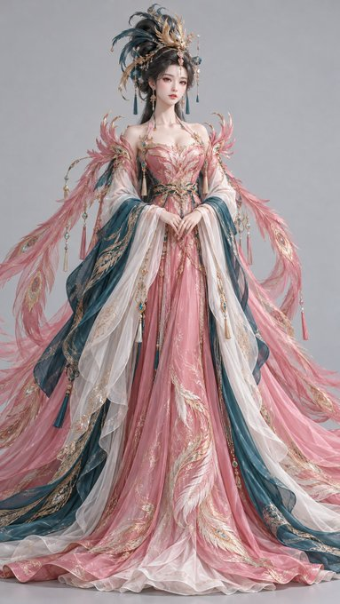

# P124. Phoenix Feather Fantasy Character

## 👀 Preview

[](../assets/p124-phoenix-feather-fantasy-character/source-example-01.jpg)

## 👇 Workflow

`Text → phoenix-feather fantasy character`

## 🔖 Full Prompt

```text
Vertical 9:16, a highly detailed stylized 3D Eastern fantasy female character prototype, high-end stylized 3D oriental fantasy character design, cinematic CG rendering, combining classical Eastern divine-bird imagery with sophisticated fantasy costume design.
An adult Eastern fantasy woman aged 24–28, with refined, luminous features, a softly oval face, long clear almond-shaped eyes, an elegant straight nose, soft supple lips, fair delicate skin with a living quality, and a noble, cool, magnificent expression. A long neck, a slender upright figure, and elegant proportions.
Sculptural hairstyle: Thick, glossy black hair is shaped into an enormous phoenix-feather updo above and behind the head. The hair sections spread upward and backward in layers like abstracted phoenix tail feathers. The updo has clearly organized strands and a smooth sheen. Insert slender gold-painted phoenix-feather hairpins and small azurite-blue enamel pieces in selected areas, with fine tassels hanging beside the ears.
Costume design: She wears an Eastern fantasy gown dominated by rosy pink, with an elongated fitted waist. Long, magnificent phoenix-tail ornaments extend from the shoulders and back. The outer draped silks and skirt combine azurite blue with moon white. Wide sleeves fall softly, and the main skirt has fine feather embroidery and gold-painted edging. The hem spreads broadly to form a magnificent, stable base.
Color control: Use rosy pink for the largest areas of the main skirt and phoenix-tail ornaments; azurite blue for secondary skirt layers and selected headdress details; moon white for the inner skirt, gauze layers, and visual breathing room; and gold pigment for detail outlines, hairpins, and embroidered accents. The overall palette is vivid and bright, but the color areas must remain clearly separated. Avoid a red cast across the whole image.
Highly detailed 3D modeling, realistic fine hair strands, softly lustrous silk, translucent gauze, delicate embroidery and metal ornaments, bright soft studio key light, subtle rim light, neutral light-gray background, and a complete front-facing full-body presentation. Avoid dolls, figurines, plastic skin, ordinary historical clothing, cheap xianxia-style fantasy costumes, text, and watermarks.
```

<sub>(by [@liyue_ai](https://x.com/liyue_ai/status/2111858511537955077)) · [Source: X](https://x.com/liyue_ai/status/2111858511537955077) · English translation by SeeAPI</sub>
