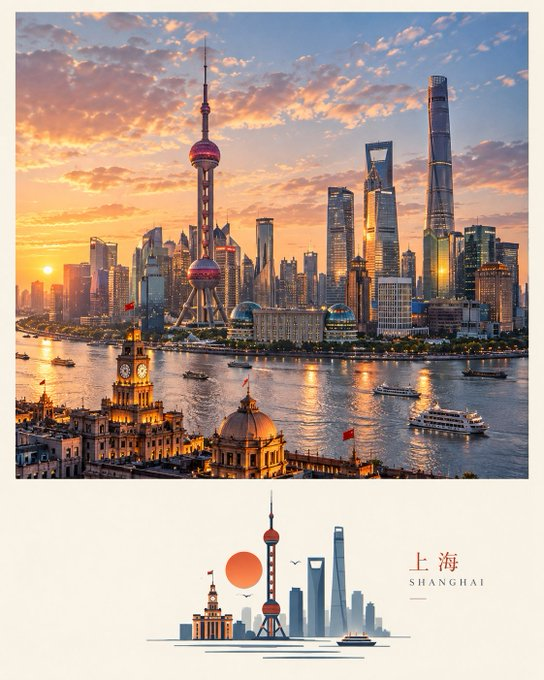
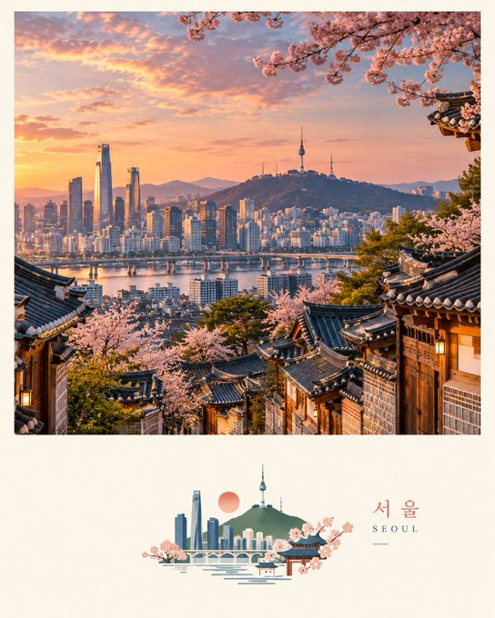
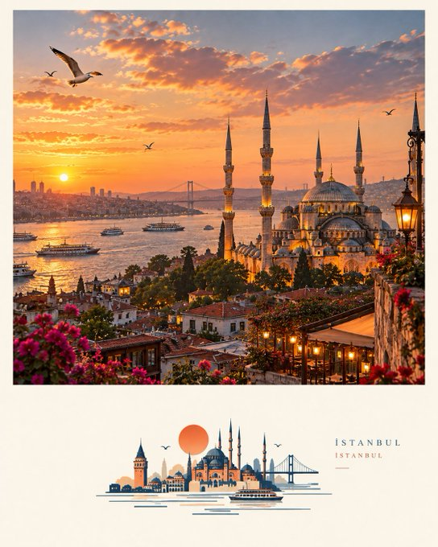
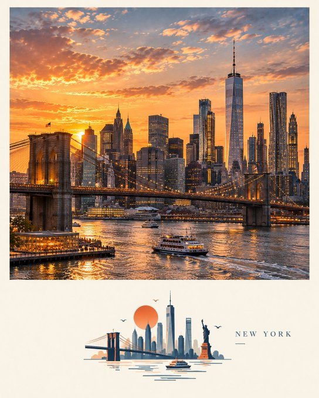

# P107. 城市景观与几何插图

[English](../p107-travel-scenes-with-geometric-vignettes.md) | [简体中文](p107-travel-scenes-with-geometric-vignettes.md)

## 👀 预览

[](../../assets/p107-travel-scenes-with-geometric-vignettes/source-example-01.jpg)

[](../../assets/p107-travel-scenes-with-geometric-vignettes/source-example-02.jpg)

[](../../assets/p107-travel-scenes-with-geometric-vignettes/source-example-03.jpg)

[](../../assets/p107-travel-scenes-with-geometric-vignettes/source-example-04.jpg)

## 👇 工作流

`目的地 → 旅行景观与几何插图`

## 🔖 完整提示词

```text
为 [COUNTRY / CITY / LOCATION / SUBJECT] 创建一幅高级 4:5 竖版编辑风旅行艺术作品。

仅文本生成图像 —— 仅根据 [COUNTRY / CITY / LOCATION / SUBJECT] 创造性地生成完整构图。无需参考图像。

核心概念
创建一个代表 [COUNTRY / CITY / LOCATION / SUBJECT] 的写实上方场景，并在下方区域搭配一个小型极简几何图形小景。下方艺术作品应在视觉上呼应主场景，但不要直接照搬它。

图形小景
自动识别 [COUNTRY / CITY / LOCATION / SUBJECT] 最强烈的 2–5 个视觉记忆点——其最具辨识度的剪影、动作、姿态、结构、物体或叙事关系。去除一切不必要的内容，使用简单几何形状、干净的剪影、纯色色块和少量经过精心分层的形状来重构这些元素。

小景应保持小巧且精致，绝不尝试重现整个场景。它可根据主体的视觉重量略微偏离中心、与边缘对齐、悬浮、局部裁切或非对称定位。

负空间
为几何艺术作品留出充裕的周围留白。将负空间视为不可或缺的设计元素，运用尺度对比、正负形、间距、聚集和非对称平衡，营造精致的编辑节奏。

色彩
从 [COUNTRY / CITY / LOCATION / SUBJECT] 的视觉身份中提取克制的 2–4 色调色板。提取与主体、环境、材质、季节、氛围、服装、建筑、植被、水域或食物相关的有意义色彩，然后将其简化并略微提亮为干净的图形色彩。

使用接近白色的非常浅、柔和背景。避免浑浊的中性色、不必要的柔和调色板、荧光色或与主体无关的装饰性色彩。

风格
保持小景小巧、简洁、精准且高度可辨识。使用专业平面设计语言，而非写实的体积感、复杂纹理或卡通风格。

无论主体是人物、建筑、动物、植物、物体、车辆还是景观，都将其转化为具有强烈视觉身份和极简几何的优雅点缀插画。

排版
如适当，仅加入极少量克制的编辑式文字。从目的地、主体、动作、情绪或视觉隐喻中提取简短词语或短语。让它保持微妙，并融入周围的负空间。

最终美学
极简几何平面设计 × 编辑式点缀插画 × 当代旅行艺术 × 巧妙留白 × 语义调色板。

成品应感觉精致、现代、活泼、设计意图鲜明且值得收藏，而非照片描摹或普通卡通。

避免照片写实的下方艺术作品、直接照搬照片、过多细节、复杂明暗、渐变、3D 渲染、过大的图形、杂乱、装饰性色彩、通用图标、过多排版、标志、水印或填满的背景。

格式：4:5 竖版，高级编辑式构图，小型几何图形小景并带有充裕的负空间。
```

<sub>(by [@Goodmanprotocol](https://x.com/Goodmanprotocol/status/2104518835076551144)) · [来源平台： X](https://x.com/Goodmanprotocol/status/2104518835076551144)</sub>
