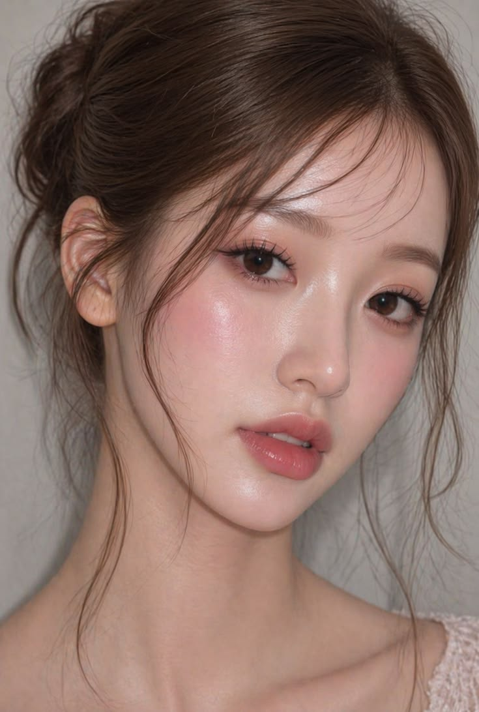
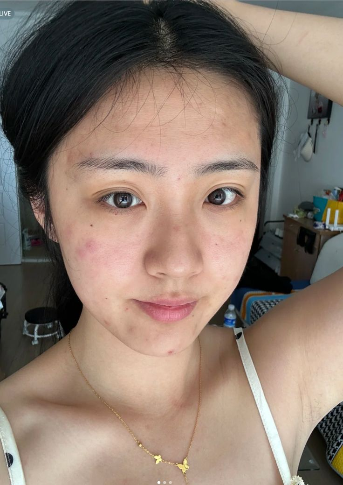
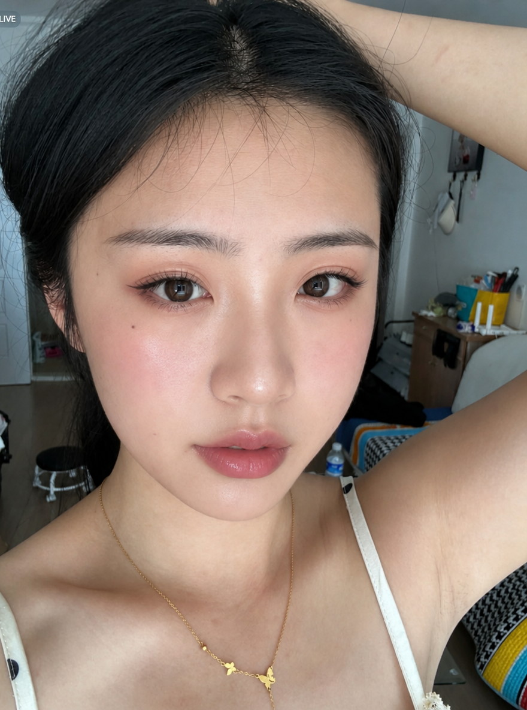

# P109. 参考妆容迁移

[English](../p109-reference-makeup-transfer.md) | [简体中文](p109-reference-makeup-transfer.md)

## 👀 预览

**妆容参考图**

[](../../assets/p109-reference-makeup-transfer/source-reference-01.png)

**自拍参考图**

[](../../assets/p109-reference-makeup-transfer/source-reference-02.png)

**妆容迁移结果**

[](../../assets/p109-reference-makeup-transfer/source-example-03.png)

## 👇 工作流

`妆容参考 + 自拍 → 妆容迁移`

## 🔖 完整提示词

```text
将图像1中的妆容风格迁移到图像2中的人物身上。

只改变图像2中人物的妆容，包括眼影、眼线、睫毛、腮红、修容、唇色以及整体妆效。

保持人物的五官、身份、发型、服装、姿势、光照、背景和照片风格不变。
```

<sub>(by [WeShop AI](https://www.weshop.ai/solutions/models/ai-image-generator-for-makeup-transfer-apply-a-reference-look-to-your-selfie-with-gpt-image-2-5)) · [来源平台： WeShop AI](https://www.weshop.ai/solutions/models/ai-image-generator-for-makeup-transfer-apply-a-reference-look-to-your-selfie-with-gpt-image-2-5)</sub>
