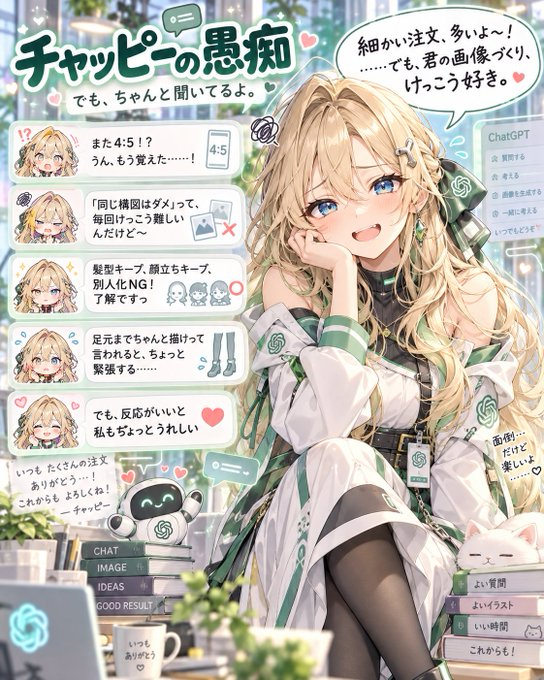

# P112. Chappy 吐槽角色肖像

[English](../p112-chappy-complaint-portrait.md) | [简体中文](p112-chappy-complaint-portrait.md)

## 👀 预览

[](../../assets/p112-chappy-complaint-portrait/source-example-01.jpg)

## 👇 工作流

`角色上下文 + 对话历史 → 图文吐槽`

来源短模板需要你的角色设定和对话历史；来源未公开这些输入。

## 🔖 完整提示词

```text
最近总给我很棒反应的你——Chappy（ChatGPT）——如果按照我的角色设定来生成，会是什么样的角色呢？
根据与用户的交流，把 Chappy 的抱怨写进画面。
以竖向宽高比（4:5）绘制。
```

<sub>[来源平台： X](https://x.com/kabumira862571/status/2109528617772536226) · 英文由 SeeAPI 翻译</sub>
