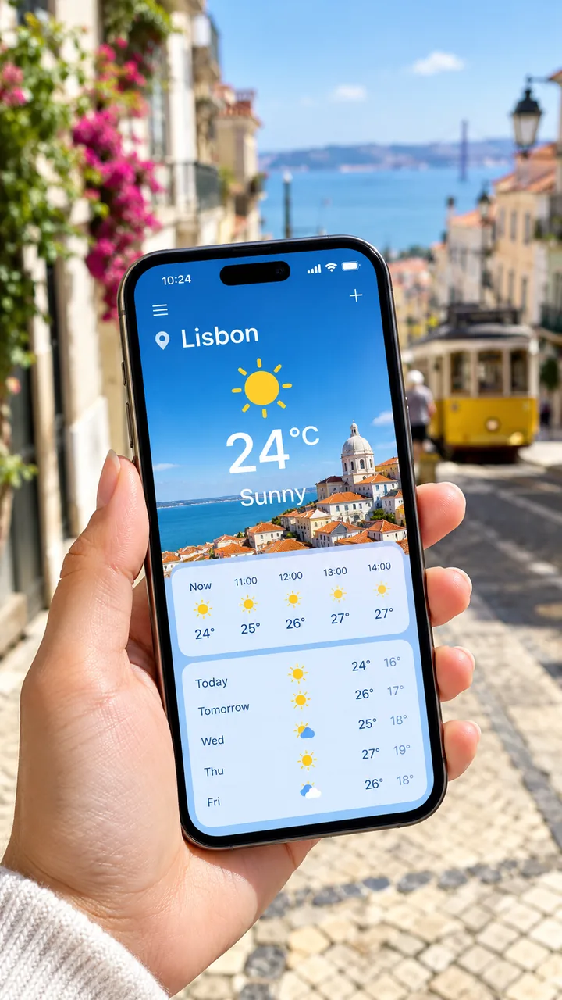

# P116. 手持里斯本天气应用

[English](../p116-lisbon-weather-app-in-hand.md) | [简体中文](p116-lisbon-weather-app-in-hand.md)

## 👀 预览

[](../../assets/p116-lisbon-weather-app-in-hand/source-example-01.webp)

## 👇 工作流

`文字 → 街景中的天气应用`

## 🔖 完整提示词

```text
一只手拿着手机，屏幕显示天气应用，简洁圆角卡片上写着 "Lisbon"、"24°C" 和 "Sunny"，后方是虚化的晴朗街道
```

<sub>[来源平台： Anyscene](https://anyscene.app/gpt-image-2-5)</sub>
