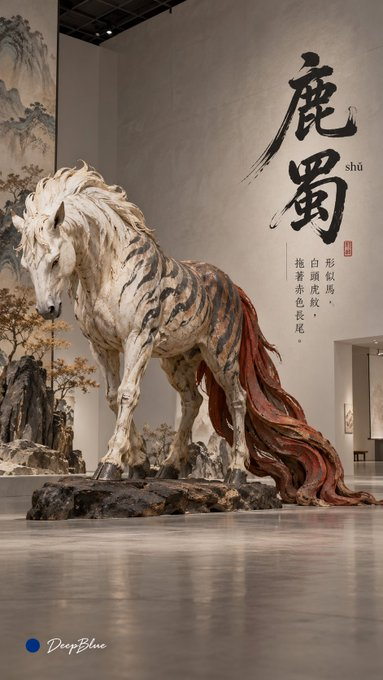
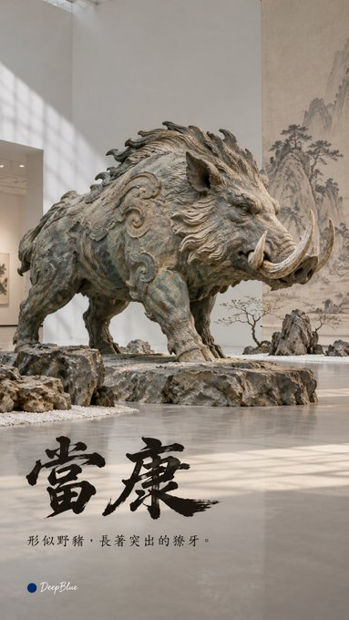
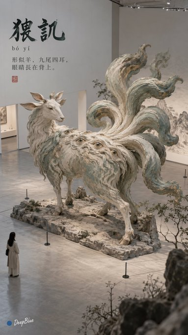
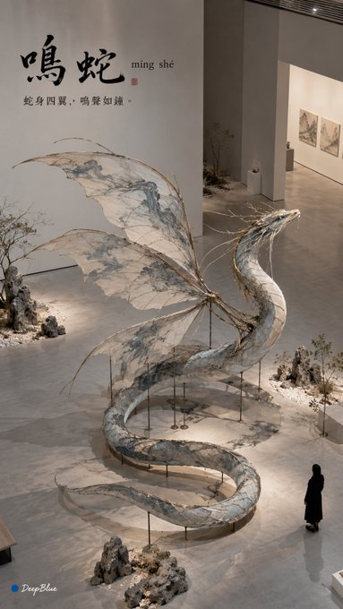

# P118. 山海经异兽展厅装置

[English](../p118-shan-hai-jing-creature-installations.md) | [简体中文](p118-shan-hai-jing-creature-installations.md)

## 👀 预览

[](../../assets/p118-shan-hai-jing-creature-installations/source-example-01.jpg)

[](../../assets/p118-shan-hai-jing-creature-installations/source-example-02.jpg)

[](../../assets/p118-shan-hai-jing-creature-installations/source-example-03.jpg)

[](../../assets/p118-shan-hai-jing-creature-installations/source-example-04.jpg)

## 👇 工作流

`异兽选择 → 展厅装置图`

## 🔖 完整提示词

```text
主题：山海经异兽 × 古典绘画空间再生 × 东方美学 × 艺术展览 Editorial

每张从《山海经》中独立选择一种形态鲜明的异兽，保留原典记载的标志性特征，将其转化为真实展厅中的大型实体艺术装置。关键形态清楚可辨，主体轮廓完整，身体结构与支撑关系自然可信。

借鉴中国古典绘画的线条、设色与气韵，融入装置自身的造型与材质。根据异兽形态独立探索制作方式，细节有所取舍，保留自然手工质感。少量山石、云气或植物意象形成空间呼应，展厅疏朗。

真实展览现场摄影，柔和光线，低饱和东方色彩，材质层次清楚，影调自然干净。构图简练，疏密有致，保留大面积艺术留白。

画面中文统一采用准确繁体字，以前卫、克制的书法 Editorial 编排异兽名称与一句通俗简短的形态介绍。

名称采用富有书写感的书法字体，随异兽气质探索篆隶意趣、行书或草书笔意，保留可辨的字形结构。通过结体、笔势、尺度、疏密与横竖布局形成古拙、神秘而富有变化的版式，文字与装置形态自然呼应。

名称中的生僻字或易误读多音字，在对应字旁小巧标注该异兽名称中的正确读音，采用带声调的汉语拼音。简介采用清晰小字，注音与正文层级分明，兼顾手机浏览的可读性。

9:16竖版，n=10。十张独立单图，选择不同异兽，分别变化材质、姿态、主体位置、拍摄视角、书法气质与文字布局，不拼图。

左下签名：深蓝色实心圆点在前，白色自然手写体“DeepBlue”在后。
```

<sub>(by [@DeepBlueX0](https://x.com/DeepBlueX0/status/2112419997125665147)) · [来源平台： X](https://x.com/DeepBlueX0/status/2112419997125665147) · 英文由 SeeAPI 翻译</sub>
