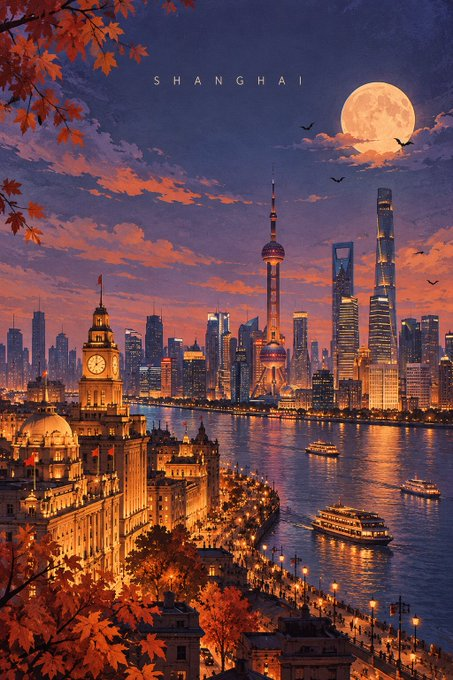
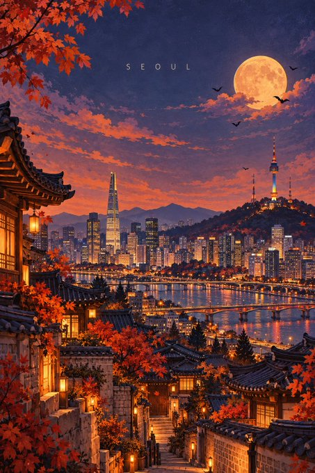

# P119. 万圣节几何旅行海报

[English](../p119-halloween-geometric-travel-posters.md) | [简体中文](p119-halloween-geometric-travel-posters.md)

## 👀 预览

[](../../assets/p119-halloween-geometric-travel-posters/source-example-01.jpg)

[](../../assets/p119-halloween-geometric-travel-posters/source-example-02.jpg)

## 👇 工作流

`目的地 → 万圣节旅行海报`

## 🔖 完整提示词

```text
目的地：[DESTINATION]

为 [DESTINATION] 创作一张精致的万圣节特别版几何旅行艺术海报。2:3 竖版，高分辨率，博物馆级编辑插画品质。

核心原则
70% 为可辨识的地标与真实城市景观，30% 为几何抽象。选择一到两处标志性地标作为一眼可辨的视觉焦点，保留其真实轮廓、建筑比例和独特细节。将周围屋顶、街道、桥梁、山丘与植物简化为优雅的几何色块。

构图
上方 40–50% 留给开阔而富有氛围的暮色天空。仅在上方中央附近，以小号、宽字距的大写无衬线字体放置“[DESTINATION]”。将真实城市景观安排在画面下半部，营造优美的建筑层次、鲜明的空间纵深和清晰的地标焦点。

万圣节氛围
将城市变为迷人、略带幽灵气息的秋日傍晚，而非恐怖场景。使用灰调薰衣草蓝天空、柔和发光的丰收月、几只小小的飞蝠、轻柔飘动的云、铜橙色秋叶，以及从历史建筑窗户透出的暖琥珀灯光。融入温和的神秘感、浪漫暮色与克制的电影魔法。根据目的地的真实建筑与地理特征调整季节细节。万圣节元素必须始终从属于可辨识的城市。

几何艺术指导
融合斯堪的纳维亚编辑插画、二十世纪中期现代几何设计和精致的建筑水粉画。以克制的拱形、半圆、矩形平面和分层剪影作为辅助构图元素，绝不压过地标。保持细致建筑与简化几何之间的优雅平衡。

色彩与肌理
将色板限制为 6–10 种协调的颜色：灰调长春花蓝、柔和紫罗兰、午夜海军蓝、陶土色、焦橙色、浅桃色、柔和象牙白和暖琥珀色。加入细腻的手工水粉、干笔、彩色铅笔和细纸纤维肌理。呈现清晰精致的博物馆艺术印刷品质，而非光滑的矢量艺术。

情绪
诗意、富有氛围、静谧而奇幻、神秘、浪漫、精致、值得收藏的万圣节旅行艺术。

避免
泛化的幻想建筑、变形地标、过大的南瓜、卡通幽灵、女巫、骷髅、恐怖画面、过多蝙蝠、霓虹橙、沉重黑色阴影、巨型几何圆形、照片写实、3D 渲染、幼稚插画、棕褐滤镜、泛黄纸张、装饰边框、标志、口号和额外文字。

最终检验
观看者应立即认出 [DESTINATION]，然后才发现细腻的万圣节魔法。成品必须像当代精美艺术旅行海报，而不是万圣节派对广告。
```

<sub>(by [@Goodmanprotocol](https://x.com/Goodmanprotocol/status/2112410576509087808)) · [来源平台： X](https://x.com/Goodmanprotocol/status/2112410576509087808)</sub>
