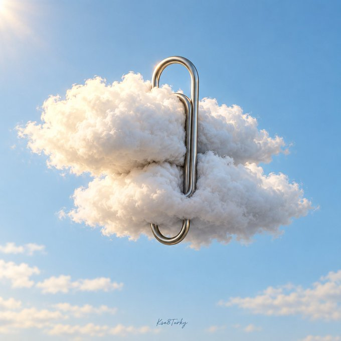

# P120. 超现实办公物件静物

[English](../p120-surreal-office-object-still-life.md) | [简体中文](p120-surreal-office-object-still-life.md)

## 👀 预览

[](../../assets/p120-surreal-office-object-still-life/source-example-01.jpg)

## 👇 工作流

`办公物件＋两个自然元素 → 超现实静物`

来源短模板。示例所用占位符实参未公开。

## 🔖 完整提示词

```text
创作一张方形、高级感的超现实编辑摄影作品：一个超大的 [OFFICE OBJECT] 与恰好两个 [NATURAL ELEMENTS] 相互作用，仿佛它们都是普通的桌面材料。呈现清晰的物理连接、可信的接触关系、可触知的表面和协调的尺度。一个视觉焦点，定向阳光，克制的色彩，大量留白。不要人物、品牌或宣传声明。加入小小的手写 Ksa8Turky 签名；不要其他文字。概念幻想。
```

<sub>(by [@ksa8Turky](https://x.com/ksa8Turky/status/2112262255295549766)) · [来源平台： X](https://x.com/ksa8Turky/status/2112262255295549766)</sub>
